# Usability review: the core modelling workflow (2026-11-01)

_Visual version of this review, with screenshots and suggested fixes: [review/index.html](review/index.html)._

Reviewed by driving the running app with real clicks and keys (Playwright, 1440×900): a phone stand from a blank page, edits to early features, error cases, save/open, the ring, pick-behind, shortcuts.

## Top 10

1. **Unknown or invalid expressions are accepted silently, evaluate to 0 and collapse geometry. Blocker.**
   - **What happens:** a dimension of `base_len` (undefined), `len=80` or `80+` is stored and the rectangle collapses. The Inspector shows `0.000` in green. The Extrude dialog and the Inspector distance fields do the same, and the strip still says "All features built".
   - **Cause:** `sketch.addDimension` stores `value: 0` without validating (builtins.ts ~1927). `evalExpr` falls back to 0 with a warning nothing shows (solver/compile.ts:65-75). The inline-edit and extrude commits don't validate either.
   - **Fix:** validate against the scope before dispatching (inline dimension, Inspector, Extrude panel), with an inline error. The commands should reject unknown names too (MCP and agents use them). Offer to create a missing parameter, and accept `name = expr`. Show `compile.warnings`.

   _Status (M1): Fixed in main (d277b07)._

   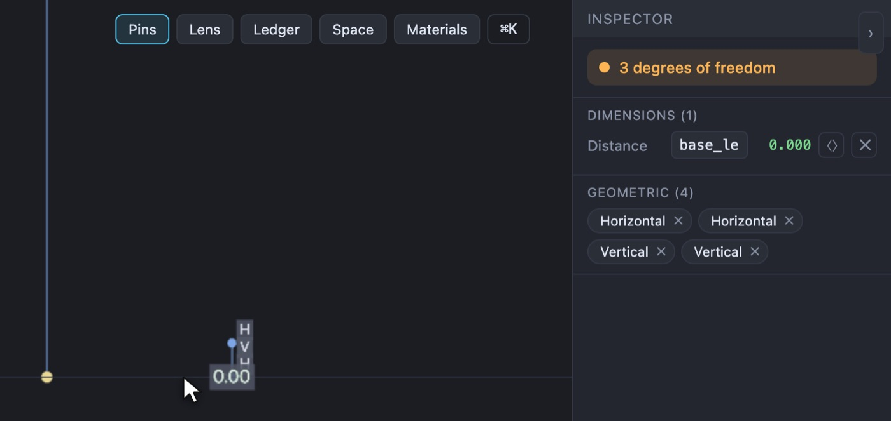

   

2. **Renaming a parameter silently breaks every reference to it. Blocker.**
   - **What happens:** after a rename, references still use the old name and evaluate to 0. The status bar even says "Added parameter".
   - **Cause:** `renameParameter` only edits the `parameter.add` op (store.ts:918-921).
   - **Fix:** rewrite every expression (dimensions, features, parameters, configurations) through the expression AST in one undoable edit, or refuse the rename.

   _Status (M2): Fixed in main (d277b07)._

   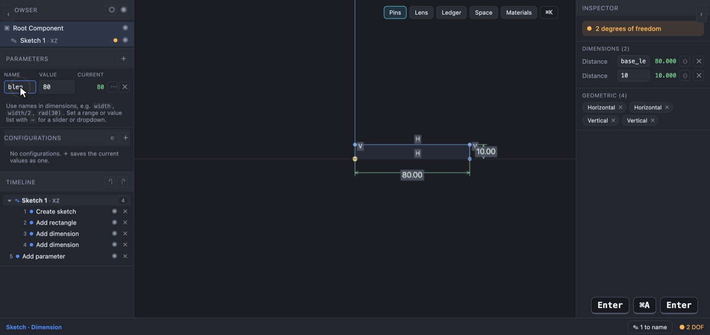

   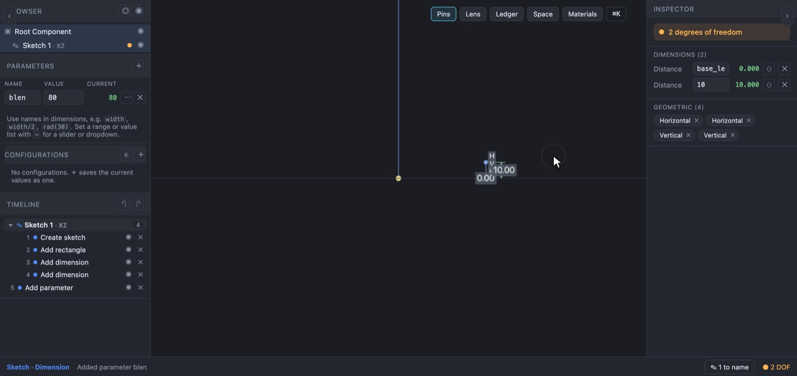

3. **Failed features are reported as built. Blocker / major.**
   - **What happens:** kernel errors (a fillet too big, an open profile, an empty sketch) leave normal chips, pins and timeline rows, show "All N features built", and quietly keep the old geometry.
   - **Cause:** featureCatalog.ts:200 sets `error: op.error` and never `solids[id].error`. The UI already renders `row.error`.
   - **Fix:** `error: op.error ?? solid?.error`, plus warnings, and a toast when a feature goes from ok to error.

   _Status (M3): Fixed in main (d277b07)._

   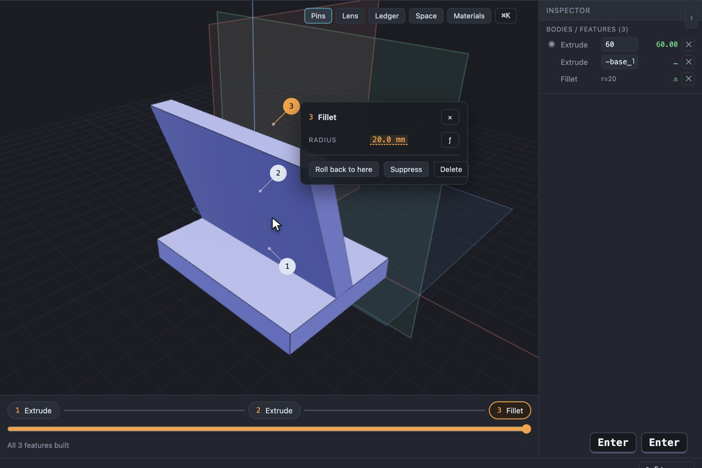

   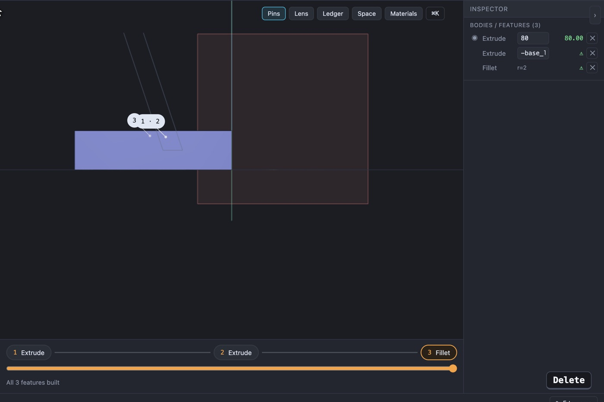

4. **Push/Pull on a face moves the wrong dimension and destroys formulas. Major.**
   - **What happens:** ＋ on a top or end face changes the extrude depth instead of moving that face. On an extrude whose distance is a formula, ＋ replaces it with a literal 0.5, and the minimum clamp flips the back. Card edits overwrite formulas the same way.
   - **Cause:** `pushTargetOf` ignores the face normal (workbench.ts:253-272). `pushTo` overwrites expressions (:292-301). The catalog clamps to 0.5 (featureCatalog.ts:55).
   - **Fix:** offer Push/Pull only on caps parallel to the extrude direction. Show formulas read-only with "edit formula…", or edit the referenced parameter. Allow negative values or add a Reverse toggle.

   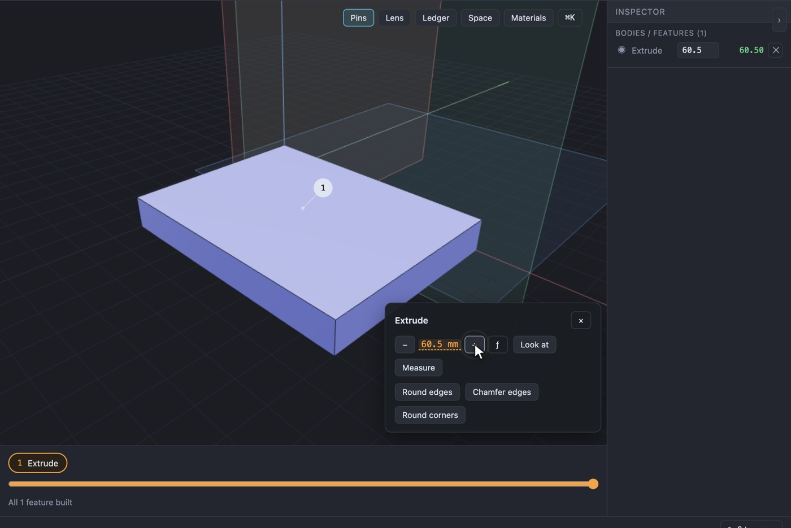

5. **Destructive actions have no guard. Major.**
   - **What happens:** Open replaces the document with no prompt and no undo, and overwrites the autosave. Deleting a parameter that's in use has no confirmation and collapses the model.
   - **Fix:** confirm Open, like New (or make it undoable). Deleting a parameter in use lists what uses it and offers to inline its value. Add a dirty indicator.

   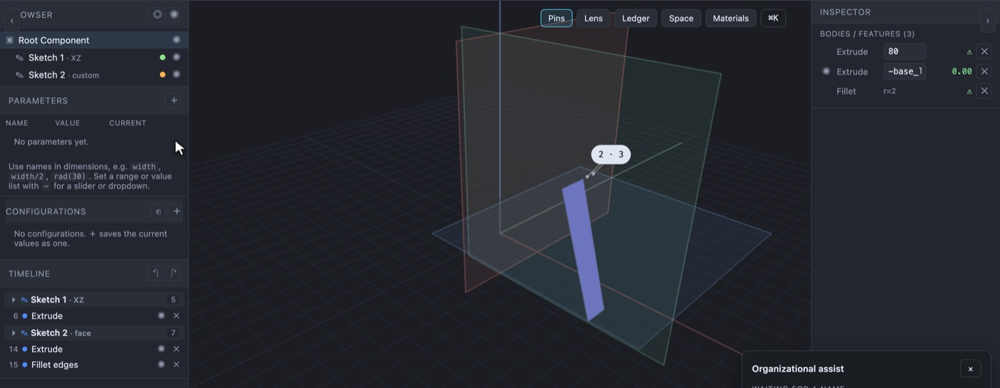

6. **Revolve, shell, pattern and edge-picked fillet/chamfer have no UI entry point. Major.**
   - **What happens:** they're reachable only through the agent and MCP, though the README lists them.
   - **Fix:** a Revolve panel (profile plus an axis: a sketch line or X/Y/Z), and an edge-pick mode for fillet and chamfer.

   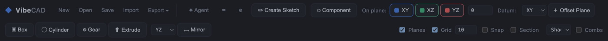

7. **Feature-card numbers look editable but clicking does nothing. Major.**
   - **What happens:** typing starts only on Enter. Expressions like `width*2` are discarded, and 800 is silently clamped to 500.
   - **Cause:** LiveNumber.tsx (no click or double-click path) and numberMath.ts:66-71 (literals only, clamped).
   - **Fix:** a click without drag, or a digit key, starts typing. Accept expressions. Show limits instead of clamping silently.

   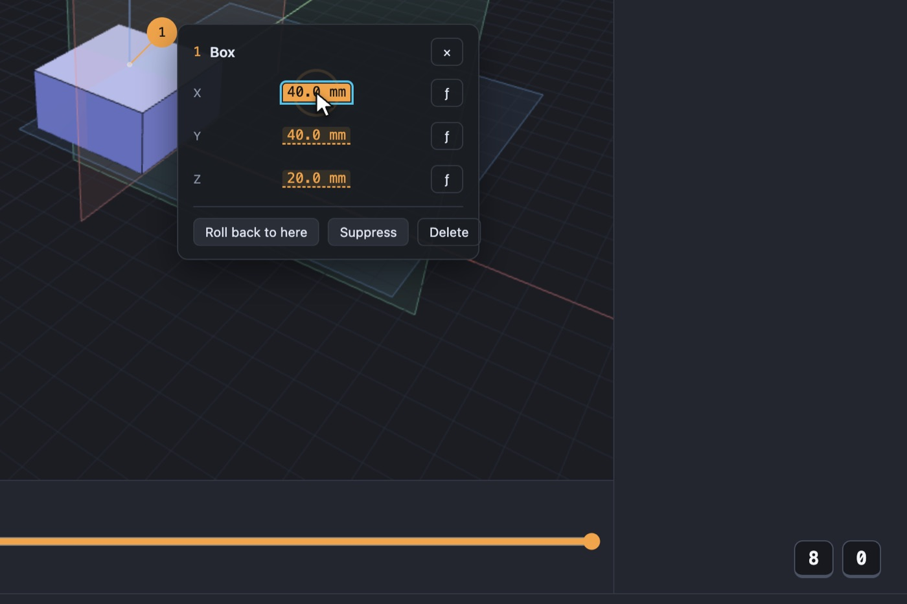

8. **In a sketch, selecting something shifts the whole canvas by 25–50 px. Major.**
   - **What happens:** the ConstraintBar grows a row, so the next click lands on something else. Sketch chrome uses about 300–370 px of 900. Clicking a line's endpoint selects the line, not the point.
   - **Fix:** give the constraint bar a fixed height (or float the selection actions), put the sketch toolbar on one row, and prefer points within a few pixels over curves when picking.

   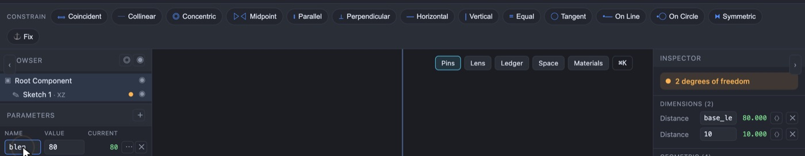

   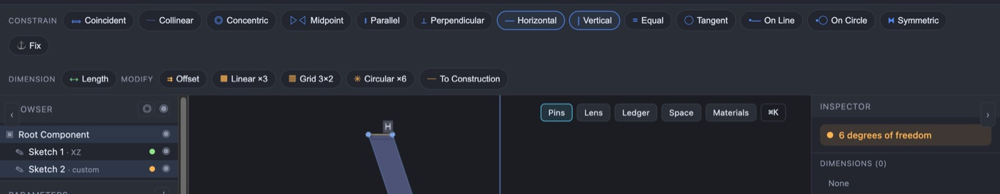

9. **Rectangles don't attach to what they snap to. Major.**
   - **What happens:** a rectangle snapped to the origin gets no coincident constraint, so it has 4 DOF instead of 2. Long-press pick-behind does nothing in a sketch.
   - **Cause:** `handleRectClick` drops `snap.ref` (interactions.ts:750-760). The same goes for the shape variants and the polygon.
   - **Fix:** carry each corner's snap and add coincident or on-curve constraints, as the line tool does. Enable long-press in sketches.

   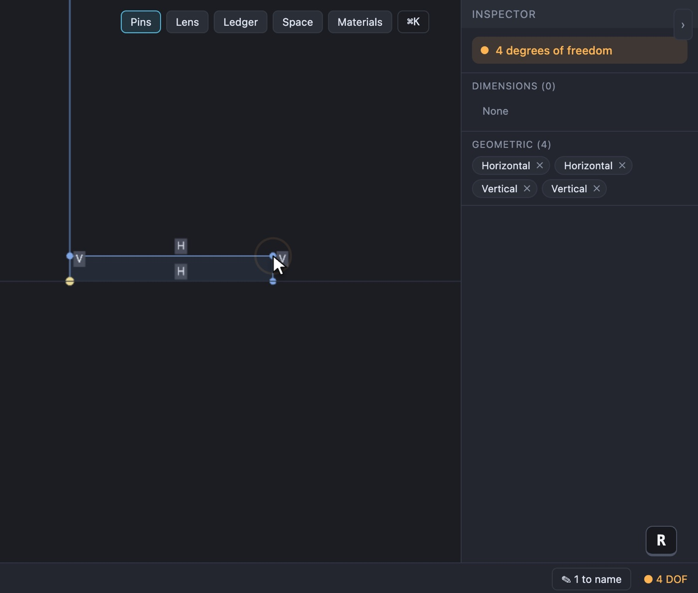

10. **You often can't see what you picked or where you're looking. Major.**
    - **What happens:** no face highlight on hover or selection, and the face card covers the face. The face card lacks Sketch and Extrude (they exist only as hotkeys and on the ring). There's no mouse way to orient the view: no view cube, and the view hotkeys are unbound. After Finish Sketch the camera stays face-on, hiding the extrude depth.
    - **Fix:** hover and selected-face highlights (reuse `setPickHighlight`), Sketch and Extrude on the face card, a view cube, and easing back to a three-quarter view on Finish Sketch.

    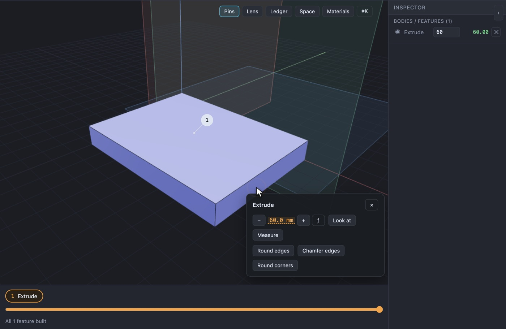

    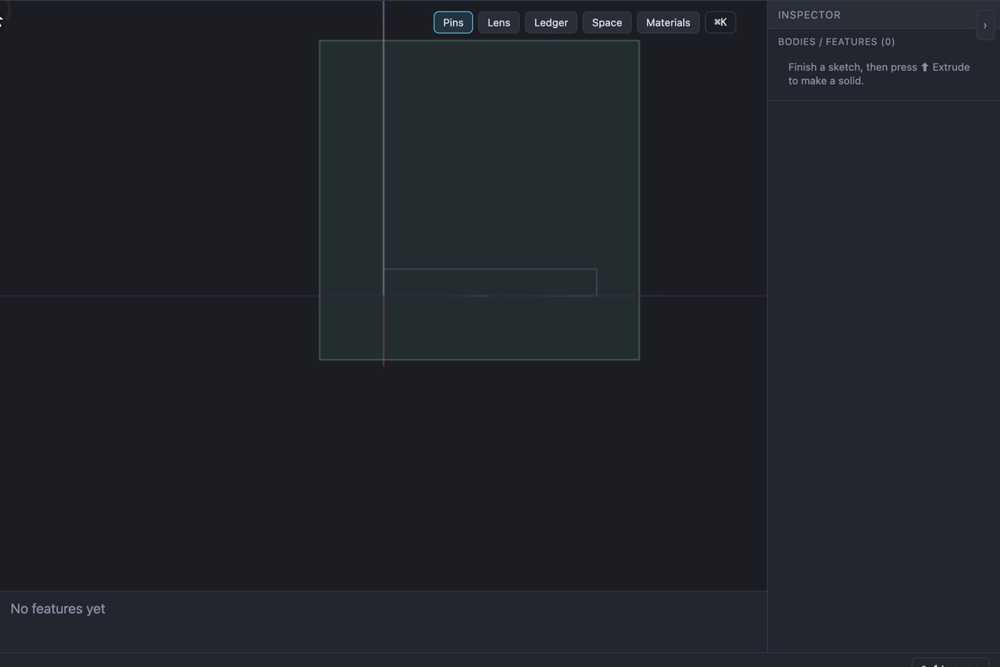

    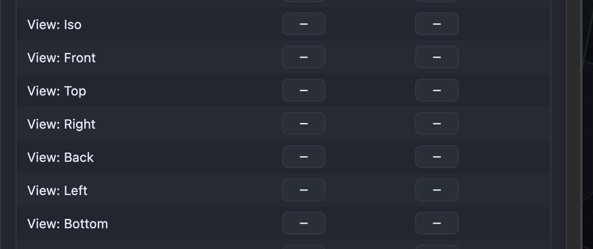

## Other findings

- **Extrude panel:**
  - it lists internal ids (`sketch2 · XZ`), and empty and open sketches;
  - no Reverse or Through-all, though the README lists them;
  - extruding a sketch with no closed region is accepted silently.

  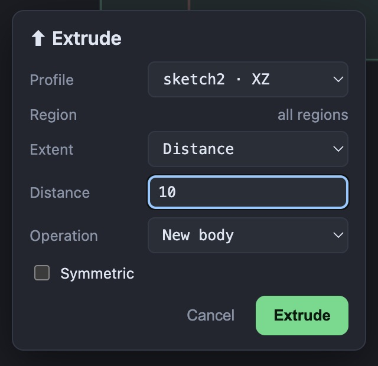

  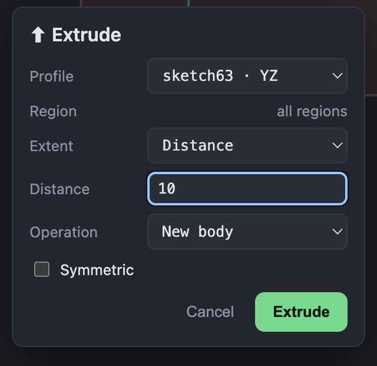
- **Over-constraint message** uses internal ids ("sketch2 — conflicts: d18, d51"). Offer to make the new dimension driven instead.

  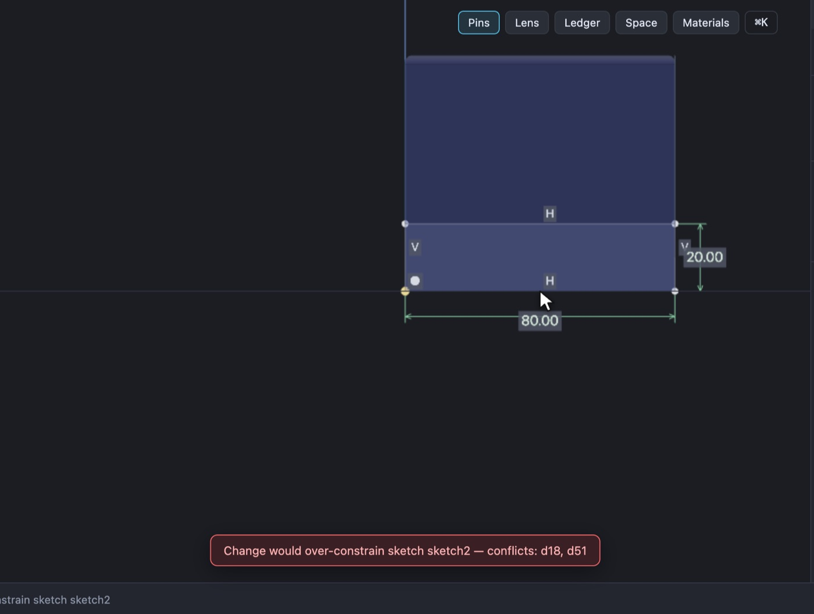
- **Stale status-bar messages** across New, Undo and mode changes. Undo and redo give no feedback.

  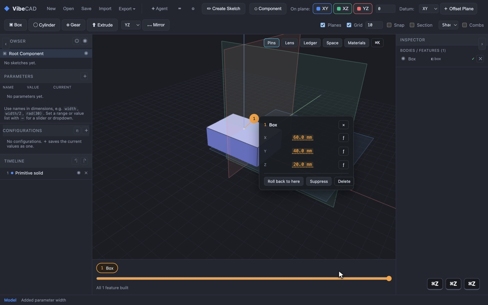
- **The three history views disagree:**
  - the Timeline numbers ops and the strip numbers features;
  - their names differ ("Primitive solid" vs "Box");
  - ghosted chips rename themselves.

  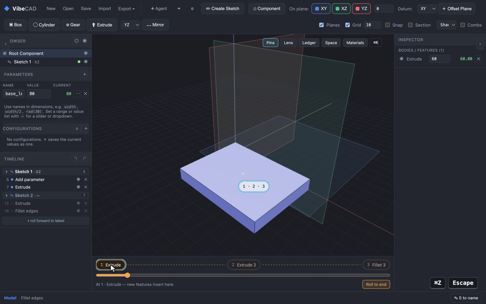
- **Clicking a history chip rolls back** rather than opening the feature. A plain click should open the card, with rollback on ⌥-click or the slider.

  
- **No rename** for sketches or features except through the assist inbox.
- **Parameters panel:**
  - the name field commits only on blur, not Enter;
  - ＋ doesn't focus the new name;
  - "Name this number" makes two undo steps.

  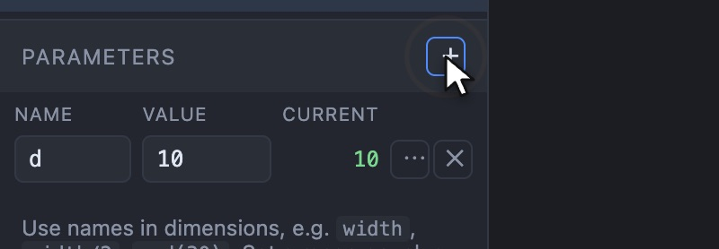
- **Browser tree:**
  - a single click on a sketch row enters sketch edit (easy by accident);
  - an empty finished sketch is left behind.
- **Pick-behind labels** leak topology names ("Extrude · side" for a top face).

  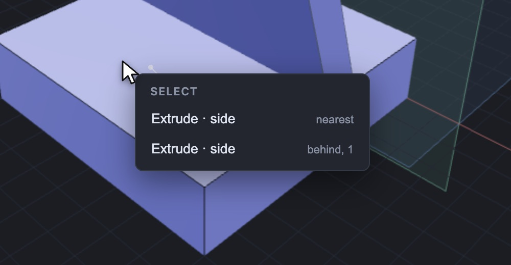
- **Line tool:** closing the loop keeps the chain rubber-banding.
- **Save:**
  - Cmd+S does nothing;
  - it always downloads `model.vibecad.json`;
  - there's no document name or dirty indicator.
- **Escape** doesn't close the Keyboard-shortcuts dialog or the assist panel.

  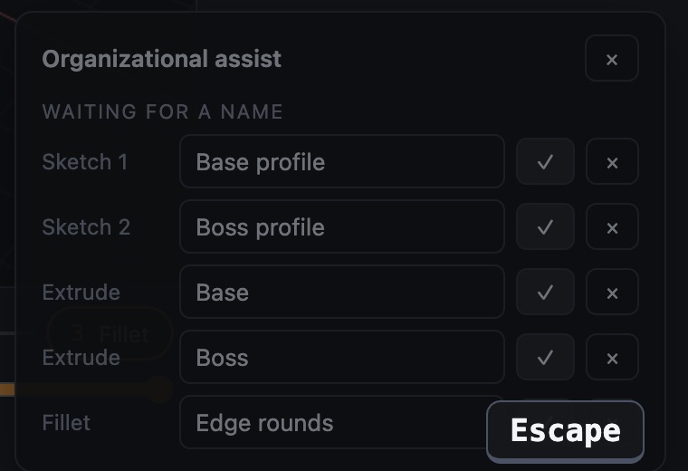
- **Toolbar:**
  - the unlabelled "0" box is shared by sketch-offset and offset-plane;
  - the unlabelled "YZ ▾" is the mirror plane.

  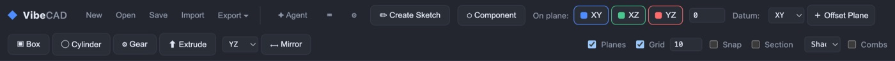
- **Polish:**
  - "⌨" renders as "▬";
  - "OWSER" is clipped by the collapse button;
  - the Analysis select is truncated;
  - ring labels are truncated, and the ring isn't clamped to the viewport;
  - an empty new sketch says "Fully constrained";
  - every constraint button is enabled regardless of the selection;
  - the assist panel covers the last chip.

  _Status (M24): Partly fixed in main: the toolbar keyboard button is an SVG icon now; the ring hint text still says "⌨" (source check, not re-tested)._

  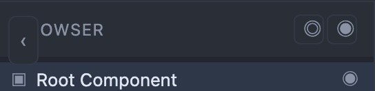

  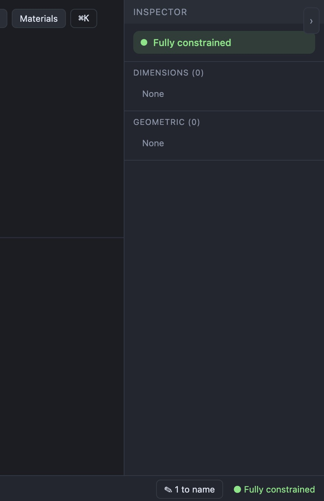
- **Lead, not verified:** "Round edges" stores its edges as a coordinate plane, so they may be lost when the geometry moves.

## What works well

- Instant Box and "Name this number".
- Inferred H/V and snapping, and live DOF.
- Over-constraint is rejected.
- Sketching on a face is smooth.
- The live extrude preview, and Join on face sketches.
- One-click Round edges.
- Downstream rebuilds after early edits, and reliable undo.
- Rollback ghosting.
- The context-aware ring, and right-click opens it.
- Long-press pick-behind in model mode.
- A clear hotkey panel.
- New confirms, and a bad file gives a clear error.
