# Usability review: concept panels and power features (2026-11-01)

_Visual version of this review, with screenshots and suggested fixes: [review/index.html](review/index.html)._

Each finding below was reproduced in the running app (Playwright, 1440×900).

## Top 10

1. **The Settings modal is taller than the window, so the API key field and its close button are unreachable. Blocker.**
   - **What happens:** the modal is 1189 px tall and starts above the screen. Esc does nothing. The Agent's "Connect your key in Settings" path is a dead end.
   - **Cause:** `.modal` has no max-height or overflow (styles.css:1098), and SettingsPanel has no Esc handler (SettingsPanel.tsx:66).
   - **Fix:** a modal that fits the viewport with a scrolling body and sticky header, Esc to close, and opening scrolled to the API key when reached from the Agent drawer.

   _Status (P1): Partly fixed in main: the modal now has a viewport max-height and a scrolling body. Escape handling and opening at the API key are still open (source check, not re-tested)._

   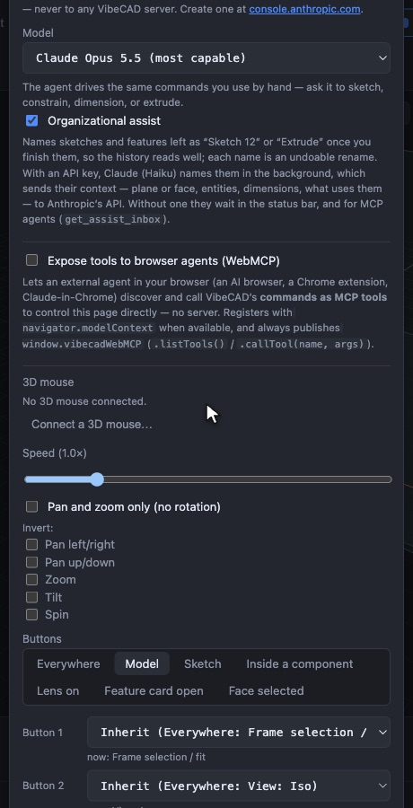

   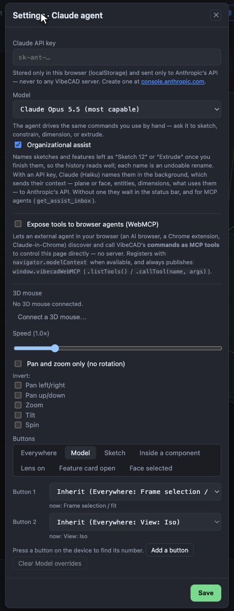

2. **Sweep and dragging on the Space map flood the undo history. Major.**
   - **What happens:** one Sweep adds 40 undo entries and ends where it started. One map drag adds 24. A Sweep keeps running after you switch tabs, with no Stop control.
   - **Cause:** mechanismStore.ts:187-201 and space/index.tsx:44-53 write a parameter on every move.
   - **Fix:** preview the values live and commit one undoable step on release; a Sweep commits nothing. Stop the sweep when its panel unmounts, or show a Stop chip.

   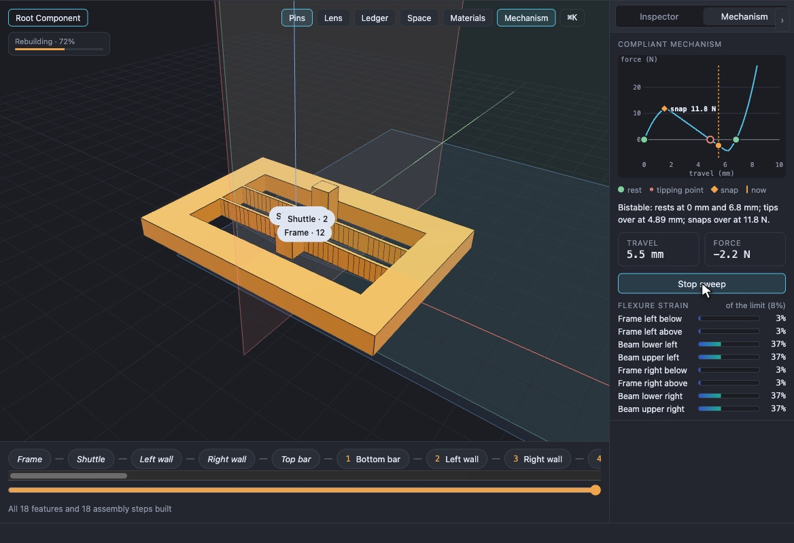

   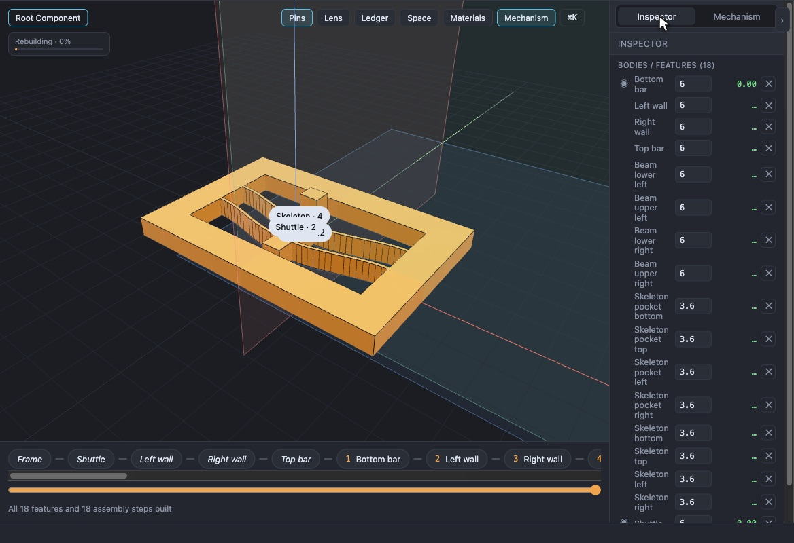

3. **Materials: Apply often does nothing, or silently breaks a parameter-driven material. Presets duplicate. Major.**
   - **What happens:**
     - "Whole model" loses to a component's `materialChoice`.
     - Applying to a component deletes its `materialChoice` without a word (builtins.ts:1013).
     - Clicking a preset twice makes two copies.
     - Nothing marks the material actually in effect.
   - **Fix:**
     - Say when a part follows a parameter, and ask before overriding.
     - Make "Whole model" apply to every part, or relabel it.
     - Reuse a preset already in the document.
     - Mark the effective material.

   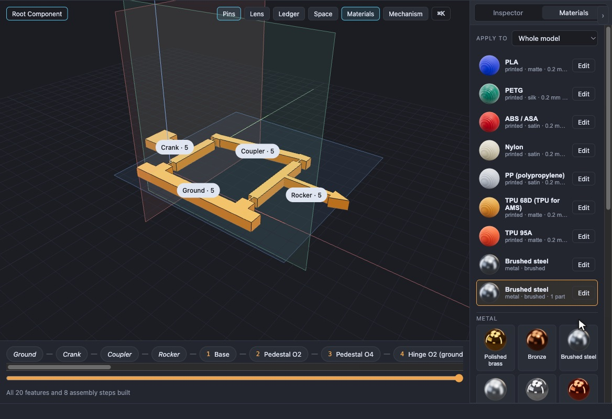

4. **The Lens card covers the panel switches and the breadcrumb. Major.** `hudPlacement` puts the wipe card at y 12 (lens.ts:44-57). Treat the toggle bar and the breadcrumb as keep-out zones.

   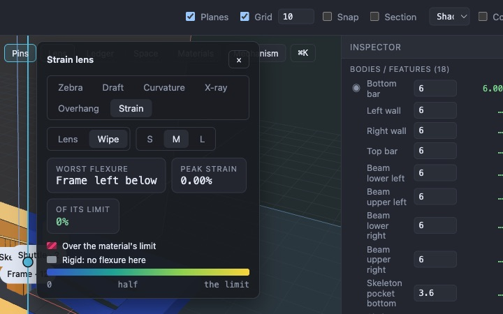

5. **Component badges never merge into clusters, so they stack into an unreadable pile. Major.** It's visible on bistable, gripper and roubo. Feature pins are clustered, but the other-component badges aren't (Pins.tsx:95-104). Cluster them too.

   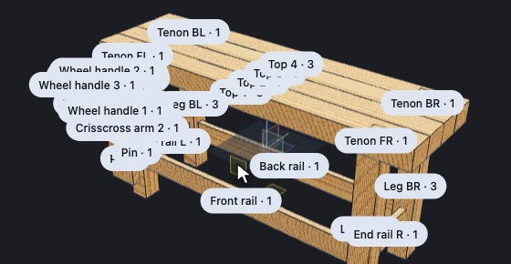

   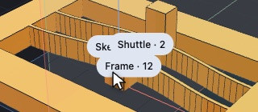

6. **The panel switches and side-panel tabs fight each other, and the switch row has nowhere to go. Major.**
   - **What happens:**
     - Clicking a lit switch whose tab is hidden turns it off instead of bringing its tab forward (uiState.ts:76-79).
     - Wide side panels push the switch row into the breadcrumb (SIDE_MAX 640 each, no minimum viewport).
     - The Agent drawer covers the switches.
   - **Fix:**
     - The first click brings the tab forward; the second turns it off.
     - Keep at least ~480 px for the viewport.
     - Let the row wrap or overflow.
     - Offset the drawer.

   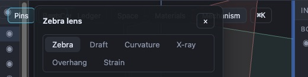

   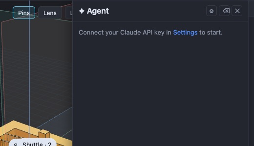

7. **Design Space sampling is slow and quiet, and its labels mislead. Major.**
   - **What happens:**
     - Starbox's 9×9 grid reaches 31/81 cells after 120 s, shown only by small grey text.
     - Map text is about 5 px on screen (space.ts:311, space.css:14).
     - "Jump to lightest" keeps that label whatever the shading metric is.
     - "All intents" is shown in the failure red even when there are none.
     - Drags write unrounded values (59.3292).
     - The Ledger's fix search runs about 31 s with no count.
   - **Fix:**
     - Time the first cell and drop to 5×5 when builds are slow.
     - A real progress bar with time remaining.
     - Fixed-pixel map text.
     - Name the button after the metric.
     - Hide the empty legend row.
     - Snap to the parameter's step.
     - Show "tried N of M" in the Ledger.

   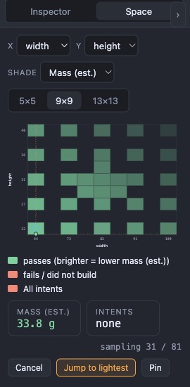

   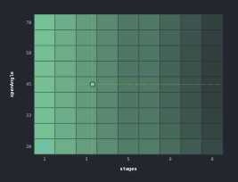

8. **Ledger: the intents section is buried under every feature sentence. Major.**
   - **What happens:** on starbox you scroll past 23 sentences to reach it. The rejection message ("Write a comparison…") appears below the fold. Values show no unit ("now 33.8").
   - **Fix:** put Intents and Suggestions first, scroll errors into view, and give built-in metrics default units.

   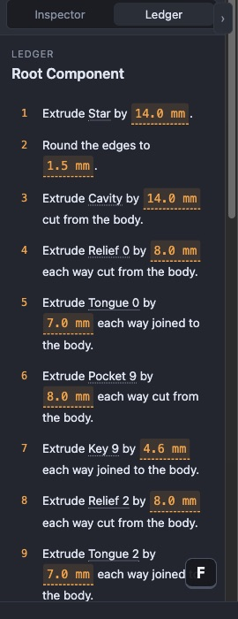

   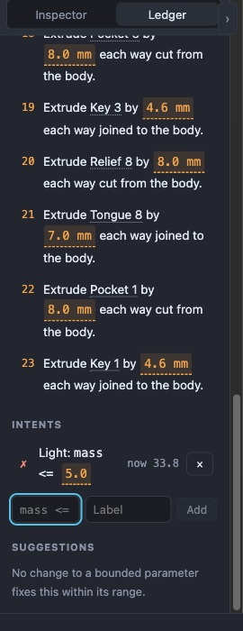

9. **⌘K doesn't know the app's own words, and an empty palette suggests nothing. Major.**
   - **What happens:**
     - "pins" offers the action ring.
     - "mechanism" offers Sweep only.
     - section, agent, configuration and help find nothing.
     - "stl" matches "Shuttle".
     - Panel results say "Workbench" rather than "Pins".
   - **Fix:**
     - Aliases that match the button labels.
     - Actions for Section, Agent, Settings, Shortcuts and Configurations.
     - Recent and common commands when the box is empty.
     - Fuzzy matches only at word starts.

   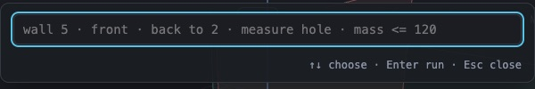

10. **The shortcuts button shows as a blank bar ("⌨" renders as ▬), and the shortcuts dialog ignores Esc. Major for discoverability.**
    - **What happens:** the ring's centre says "configure in ▬", which points nowhere (Toolbar.tsx:198, HotkeyPanel.tsx:22-34).
    - **Fix:** an SVG icon or the word "Shortcuts", and Esc to close.

    _Status (P10): Partly fixed in main: the toolbar button is now an SVG icon. The ring hint still says "configure in ⌨", and the dialog has no general Escape handler (source check, not re-tested)._

    

    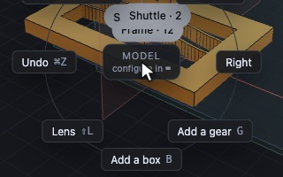

## Other findings

- **Major: a long-press picker after the first orbit.** It opens after the first orbit of a freshly loaded model, probably because the long-press timer fires while the main thread is busy (interactions.ts:291-310). Check the pointer's travel inside the timer instead.
- **Major: the toolbar reflows with context and moves the viewport.**
  - The component chip pushes Datum to a second row.
  - Starbox's 22 datum planes become two rows of pills.
  - Section adds a third row.
  - The Shading select is cut to "Sha▾".

  Put the datum planes in a dropdown and give the toolbar a fixed height with overflow.

  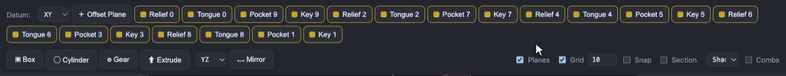

  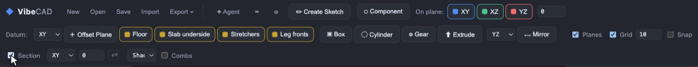
- **Minor: collapse buttons overlap headers** ("OWSER"). Move them into the header row.

  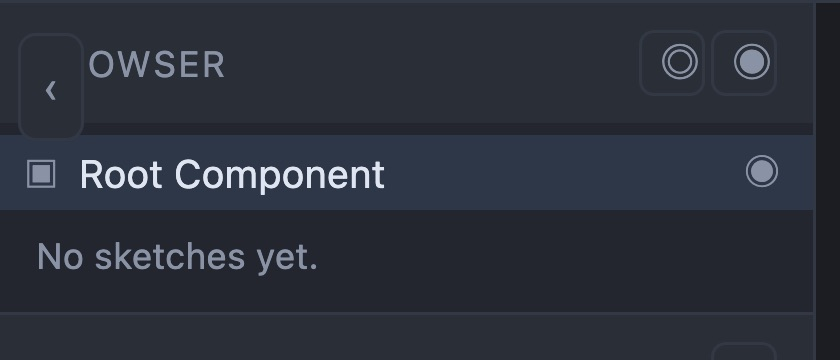
- **Minor: a 272 px default side width is too narrow.** Parameter names and expressions are cut, and Inspector names wrap to four lines. Default to about 320 px.

  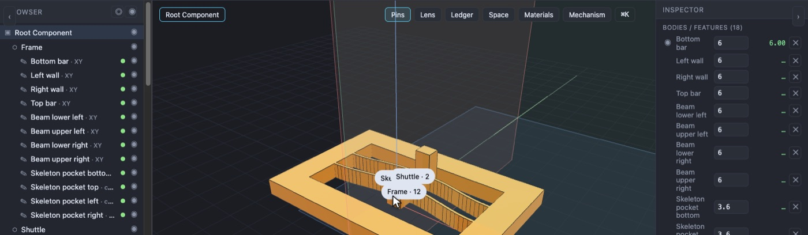
- **Minor: the configurations grid.**
  - Default-row expressions wrap in 48 px columns.
  - A new configuration captures every parameter, pushing the add-column control off screen.
  - The paste icon (⎘) isn't clear.

  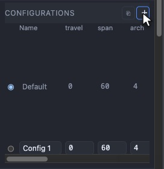
- **Minor: parameter edits from the map, a sweep or the Inspector say "Added parameter …"** because they re-run parameter.add (store.ts:902). They should say "Set x = …".

  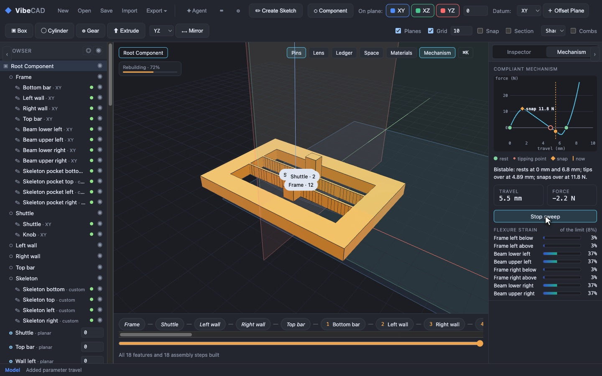
- **Minor: duplicate analysis controls.** The toolbar's shading select duplicates the Lens modes, and zebra stripes can only be changed in the toolbar.

  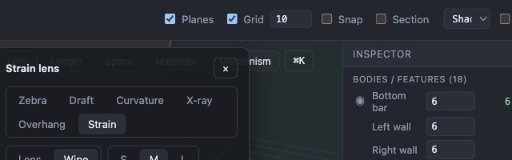
- **Minor: shop drawing.**
  - Duplicate React keys for identical cut-list rows (DrawingView.tsx:79).
  - "Show in the viewer" is jargon (it means customize mode) and changes the document from an export dialog.
  - The sheet uses only the left half.
  - The PDF download gives no confirmation.

  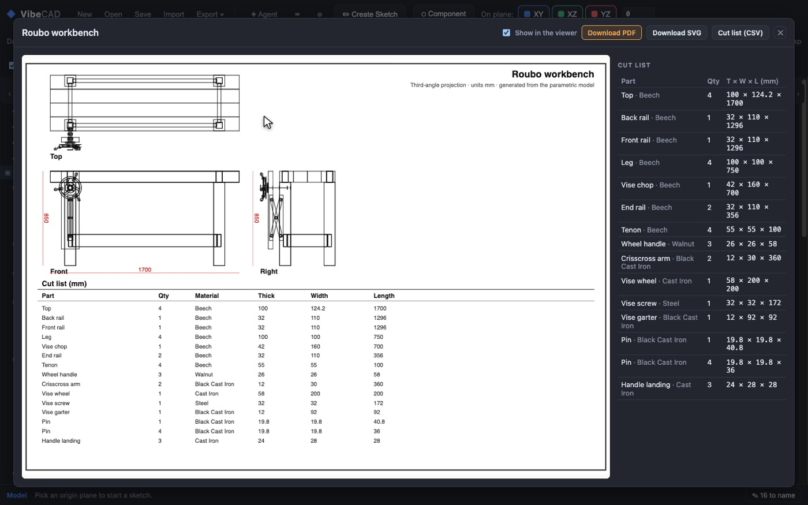
- **Minor: Pins also hides the history strip**, without saying so.
- **Minor: the motion study is unreachable from the editor**; it exists only in customize mode.

  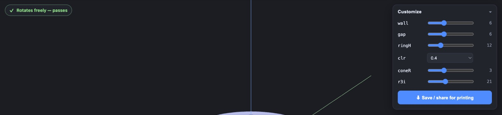
- **Minor: inconsistent names** for the same panels across buttons, hotkeys and headers ("Pins" / "Workbench", "Space" / "Design Space"). Materials has no hotkey action.

  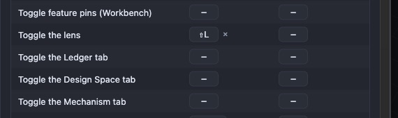
- **Polish:**
  - The Overhang readout should show the area that needs support.
  - The shortcuts dialog jumps between Keys and Ring.
  - In the ring editor, the N slot overlaps NW and NE.
  - Pins and ring labels overlap.
  - The Space empty state is set in a larger type than the panel.
  - The Ledger header says "Root Component" instead of the document name.

  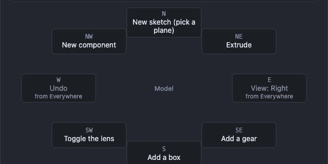

## What works well

- **Mechanism panel:** a plain-English summary, readable strain bars, and the curve in 1–3 s.
- **Action ring:** fast, with hold, tap and right-click all working; slots show their hotkeys.
- **⌘K:** parameter edits and intents work well.
- **Lens:** instant mode switches and clear legends.
- **Space sampling:** runs in a worker, keeping the viewport at 60 fps.
- **Shop drawing:** about 3 s, PDF in about 250 ms, and the CSV cut list.
- **Customize motion study:** shows its progress.
- **Side resizers:** highlight on hover, remember their widths, reset on double-click.
- **Empty states:** clear.
