# Usability review: customize viewer, first run, accessibility, responsiveness (2026-11-01)

_Visual version of this review, with screenshots and suggested fixes: [review/index.html](review/index.html)._

Tested in the running app on desktop (1280×800, 1440×900) and on a phone (390×844, touch).

## Top 10

1. **Save exports stale geometry while a rebuild is still running. Blocker for a print tool.**
   - **What happens:** set starbox's width to 100 and save within ~3 s: the STL is still 64 mm wide.
   - **Cause:** `shareModel` reads `solids` right away (store.ts:1282).
   - **Fix:** flush the editCommitter, `await whenRebuilt()` first, and show "Updating model…" while it waits.

2. **Save gives no feedback, and double-clicking saves twice. Major.**
   - **What happens:** clockwork's 3MF takes 26 s with no busy state; bistable gave two STLs.
   - **Fix:** a saving state that disables the button and says what it's preparing, plus a toast when done. Consider labelling the button with the format.

3. **The drawing dialog can't be used on a phone. Major.**
   - **What happens:** the sheet collapses to 0 px wide, ✕ is off-screen, and the action buttons are clipped.
   - **Cause:** `.drawing-body` is `1fr 300px` (styles.css:1455).
   - **Fix:** below 720 px, stack the sheet above the cut list, make the dialog full screen, and wrap the actions.

   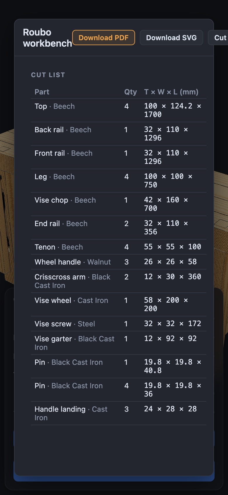

4. **The viewer shows no progress for long loads or rebuilds. Major.**
   - **What happens:** clockwork shows "Loading…" for 17 s, and starbox rebuilds for 3.8 s with nothing on screen.
   - **Cause:** BuildProgress is mounted only in the editor.
   - **Fix:** mount it in CustomizeApp, and show the build percentage in the loading overlay.

   

5. **The Settings dialog is taller than the window, and Escape closes neither it nor Shortcuts. Major.**
   - **Cause:** `.modal` has no max-height or overflow (styles.css:1098); no Escape handlers (SettingsPanel.tsx:66, HotkeyPanel.tsx:60).
   - **Fix:** a viewport-capped, scrolling modal that closes on Escape.

   _Status (V5): Partly fixed in main: the height cap landed; Escape handling did not (source check, not re-tested)._

   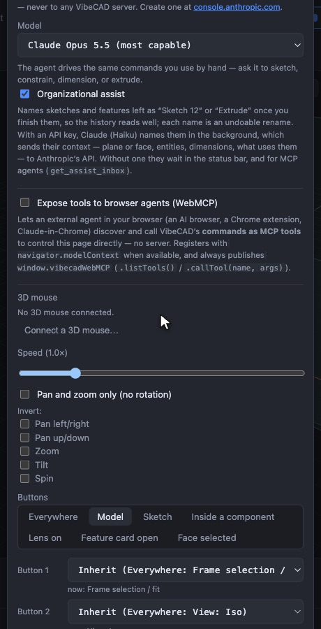

6. **Dialogs don't manage focus, and most aren't marked as dialogs. Major (accessibility).**
   - **What happens:** focus stays behind them, and Tab walks the toolbar under the backdrop. Settings and Shortcuts lack `role="dialog"` and `aria-modal`. The drawing dialog drops focus on close.
   - **Fix:** one shared `<Modal>` with role/aria-modal/aria-labelledby, initial focus, a focus trap and focus restored on close (the kit `Dialog` is the model).

   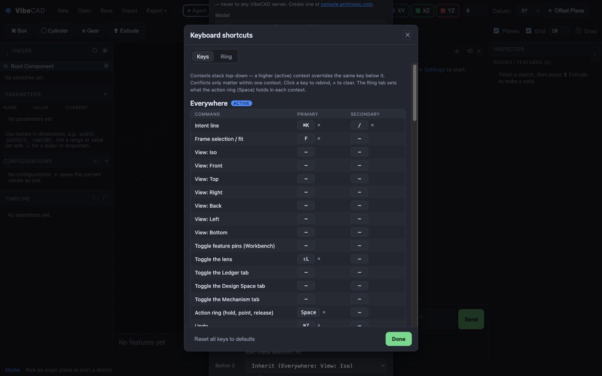

7. **Viewer controls show developer names (`L`, `TT`, `r3i`) with no units, hints or way to type a value. Major.**
   - **What happens:** every model's page title is "VibeCAD", and there's no description. Exact values are impossible: L runs 1200–2400 on a 206 px track.
   - **Fix:** optional `label`, `description` and `unit` on Parameter; an editable value field; a model title, intro and `document.title`.

   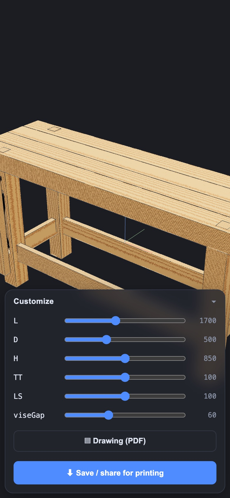

   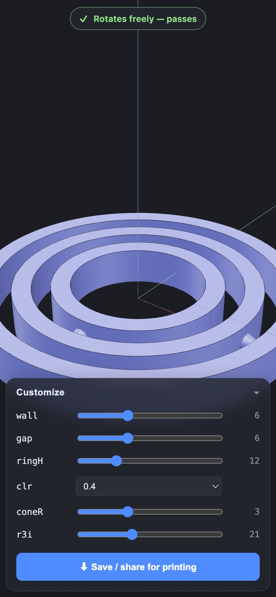

8. **The motion check can take minutes and restarts after every touch. Major.**
   - **What happens:** clockwork's verdict takes 129 s, any edit resets it, and "Rotates freely" is hard-coded.
   - **Fix:** an estimate; keep the last verdict ("before your change"); cache per parameter set; a coarse pass first, then refine; word the verdict by joint type.

   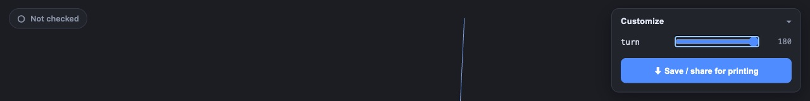

   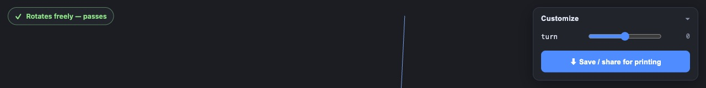

9. **On a phone, the model is framed behind the bottom sheet; origin axes clutter product views; Save can sit below the fold.**
   - **Fix:** frame into the area above the sheet, hide the axes in customize mode, and pin Save and Drawing in a footer outside the scroll.

   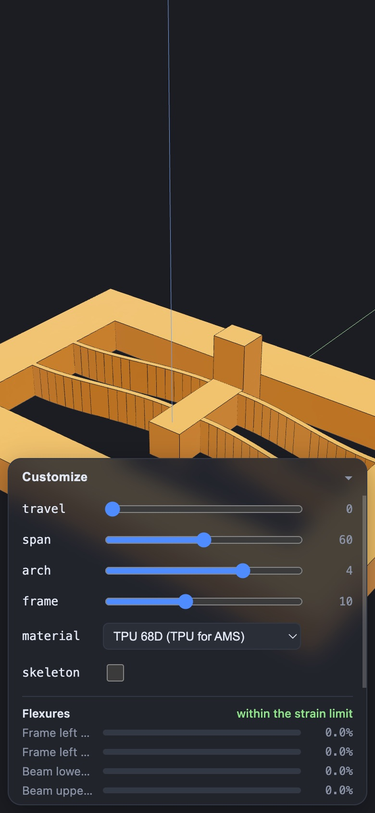

   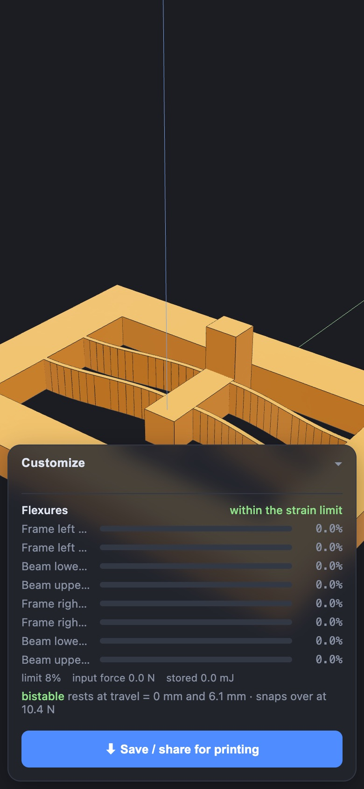

10. **The main call-to-action and control borders are too low in contrast (WCAG AA).**
    - **What happens:** white on #4f8cff is 3.22:1. Input borders are 1.29–1.44:1, kit borders 1.18:1. Focus on the Save button is hard to see.
    - **Fix:** a darker CTA fill (~#2f6fe0), `--line` around #5a6275 for inputs, a more opaque sheet, and `:focus-visible` outlines.

    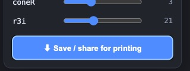

    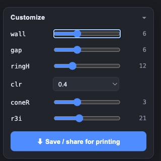

## The rest

11. **First run gives no path to the examples, a welcome or help.** Add a first-run card ("Start a sketch · Add a box · Open an example · Shortcuts ?"), an Examples entry under Open, and bind `?` to shortcuts.

    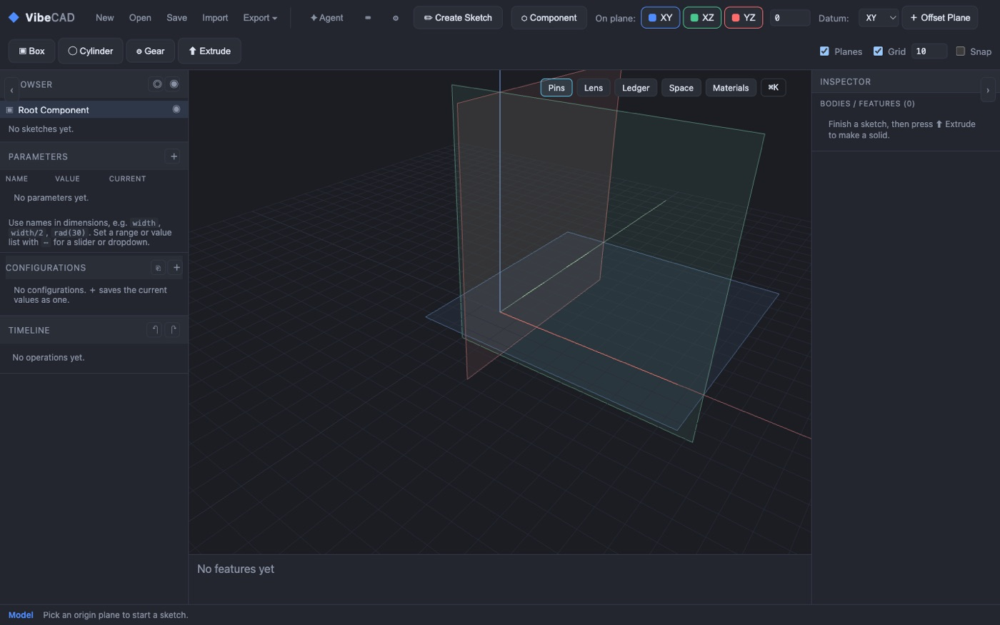
12. **The side-panel toggles cover the headings** ("OWSER") and have no names (‹ ›) or `aria-expanded`. At 800 px, the concept switches overlap the Inspector header.

    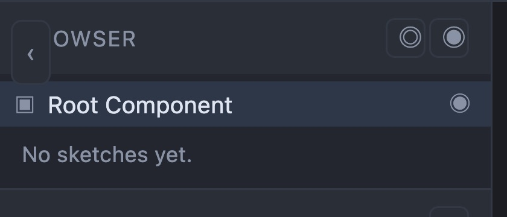

    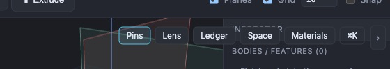
13. **The editor on narrow widths:**
    - at 390 px, the toolbar is 341 px tall and both side panels cover the viewport;
    - at 1440 px, the toolbar still wraps and cuts off controls.

    Start with the panels collapsed below 820 px, and use overflow menus.

    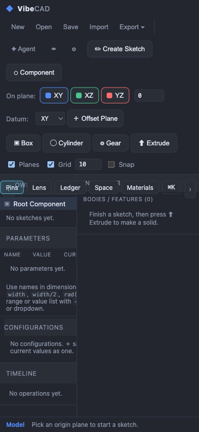
14. **Reduced motion is ignored:** the camera tweens and the CSS animations still run. Respect `prefers-reduced-motion`.
15. **The render loop draws every frame even when idle** (SceneManager.ts:485-508). Render on demand.
16. **Screen readers aren't told about status changes:**
    - no live regions for the status bar, toasts or the motion badge;
    - the canvas has no role or label;
    - the Customize handle has no `aria-expanded`;
    - slider names include their values, and there are no units or `aria-valuetext`;
    - the page has no headings.
17. **An unknown example shows a raw JSON parse error.** Detect it and say "Couldn't find the model 'nope'", with links.

    
18. **Stale or misleading status text:**
    - "Pick an origin plane…" persists during and after opening a model;
    - an empty sketch says "Fully constrained";
    - the profile is called "sketch2" though the browser shows "Sketch 1";
    - "1 to name" is cryptic.

    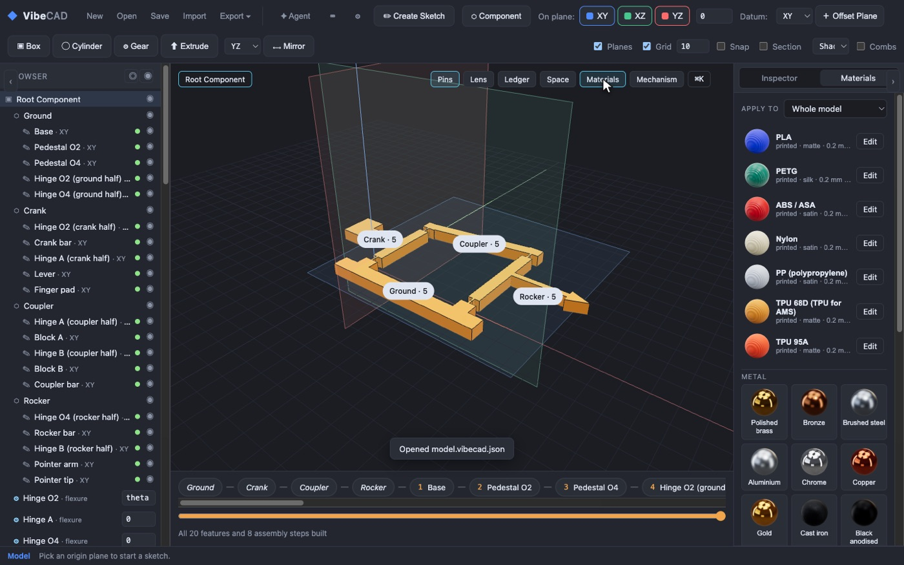

    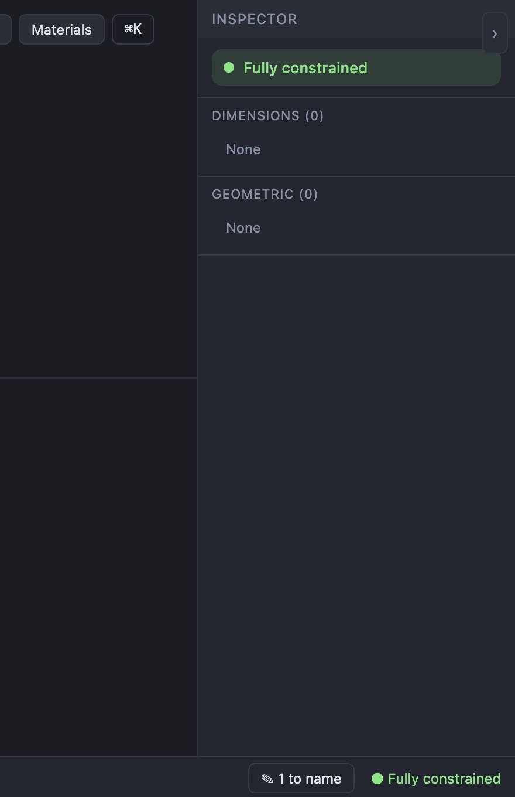
19. **The history strip says "All N built" while the build is still at 47 %.** Show "Building… n/N" instead.

    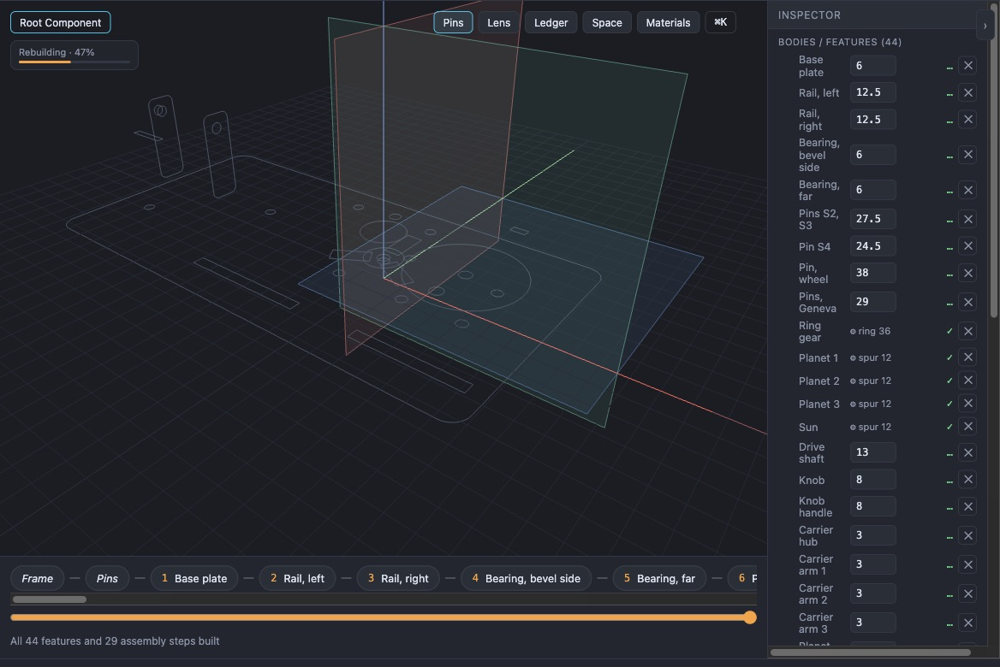
20. **The progress bar sits at 96–98 % for ~6 s on clockwork.** Weight or label the last phase.
21. **Viewer labels are truncated:** flexure names, and the material select ("TPU 68D (TPU fo").

    
22. **Toolbar glyph buttons (⌨ ⚙) render about 8 px.** Use real icons with aria-labels.

    _Status (V22): Partly fixed in main: the buttons are now SVG icons with aria-labels (source check, not re-tested)._

    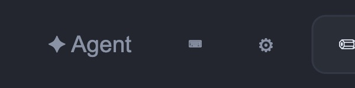
23. **The viewer would show hidden parameters that have bounds** (`bounded` doesn't filter `p.hidden`).

## What works well

- **Touch:** slider drags never orbit the model, sheet scrolling works, and one finger orbits.
- **Sliders:** track the finger instantly, and debounced commits keep rebuilds from piling up.
- **Main thread:** stays responsive during the motion study.
- **Shop drawing on desktop:** a "Drawing the views…" state, a PDF in 0.7 s and good file names.
- **Editor progress bar:** correct ARIA.
- **Kit Dialog:** a good model for the others.
- **Autosave:** restores the model after a reload.
- **Tooltips:** descriptive, with shortcuts.
- **Focus rings:** visible almost everywhere.
- **Layouts:** landscape phone and short desktop both fit.
- **Flexure readout:** informative.
